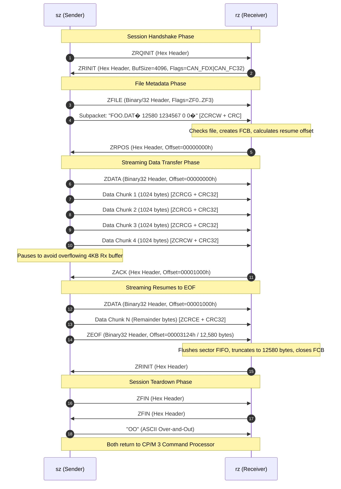

# Zmodem Protocol Implementation: rz & sz for CP/M 3

This document provides a comprehensive technical reference for the Zmodem file transfer protocol as implemented in [`rz.asm`](../rz.asm) (receiver) and [`sz.asm`](../sz.asm) (sender), authored by Wilfried Schmitten (1992) for CP/M Plus (CP/M 3.0) and Z-System on Z80 microprocessors.

---

## 1. Protocol Architecture & Operational Mission

Zmodem was designed by Chuck Forsberg to overcome the severe throughput bottlenecks of stop-and-wait protocols like Xmodem and Ymodem. In traditional protocols, the transmitter must pause after every block and await an acknowledgment (ACK/NAK) packet, resulting in channel idle times that severely degrade throughput over packet-switched networks, buffered modems (MNP/V.42), and high-latency satellite links.

### 1.1 Core Design Pillars in `rz` & `sz`
1. **Full-Duplex Sliding-Window Streaming**: The sender streams file payload continuously without halting for per-subpacket acknowledgments, utilizing `ZCRCG` subpacket delimiters.
2. **Piggybacked Flow Control & Windowing**: On systems with limited receive buffers, the sender limits unacknowledged bytes in flight to the receiver's advertised buffer capacity, periodically eliciting acknowledgments via `ZCRCQ` or `ZCRCW`.
3. **Dynamic Subpacket Sizing**: Data subpackets dynamically scale between 128 bytes and 1,024 bytes based on transmission error rates and line quality.
4. **Dual CRC Validation**: Supports both 16-bit CRC-CCITT and 32-bit CRC-32 (IEEE 802.3), dynamically negotiated via receiver capability flags.
5. **32-Bit Crash Recovery (`ZRPOS`)**: If a transfer is interrupted by line noise or carrier loss, the receiver requests transmission to resume at an exact 32-bit byte offset, eliminating redundant retransmission of already received data.
6. **Preservation of Exact File Lengths in CP/M**: CP/M file systems allocate storage in 128-byte records. Zmodem preserves the true byte length in the file metadata subpacket, enabling `rz` to truncate received files to their exact original byte size and eliminate trailing Ctrl-Z (`1Ah`) padding.
7. **Batch Transfers & Directory Scans**: `sz` supports CP/M wildcards (`*.*`), scanning directory entries, sorting files alphabetically via an in-memory Shell sort, and transferring entire batches without user intervention.

---

## 2. Frame Encoding & Header Syntax

Zmodem exchanges control information using three distinct header formats: Hexadecimal (`ZHEX`), 16-bit Binary (`ZBIN`), and 32-bit Binary (`ZBIN32`).

### 2.1 Hexadecimal Header (`ZHEX`)
Used during initial connection establishment, handshake negotiation, and session teardown. It is strictly composed of 7-bit printable ASCII hexadecimal characters to pass safely through 7-bit networks, software flow-control handlers, and terminal servers.

```text
* * ZDLE 'B' <TYPE:2> <F0:2> <F1:2> <F2:2> <F3:2> <CRC16:4> 
 
 [XON]
```

- `* *` (`2Ah 2Ah`): Two `ZPAD` characters for receiver clock synchronization.
- `ZDLE` (`18h` / Ctrl-X): Zmodem Data Link Escape character.
- `'B'` (`42h`): Identifies frame as `ZHEX` format.
- `<TYPE:2>`: Two uppercase ASCII hex nibbles specifying frame type (e.g., `'0' '1'` for `ZRINIT`).
- `<F0:2>` .. `<F3:2>`: Eight uppercase ASCII hex nibbles representing 4 bytes of frame-specific flags or a 32-bit little-endian integer.
- `<CRC16:4>`: Four uppercase ASCII hex nibbles representing the 16-bit CRC-CCITT over the type and 4 flag bytes.
- `
 
` (`0Dh 0Ah`): Carriage return and line feed delimiter.
- `[XON]` (`11h`): Optional XON character sent to unblock remote software flow control.

### 2.2 16-Bit Binary Header (`ZBIN`)
Compact 8-bit binary framing format protected by 16-bit CRC-CCITT. Used during data transmission when 16-bit CRC is active.

```text
* ZDLE 'A' <TYPE> <F0> <F1> <F2> <F3> <CRC16-HI> <CRC16-LO>
```

- `*` (`2Ah`): Single `ZPAD` character.
- `ZDLE` (`18h`): Data Link Escape.
- `'A'` (`41h`): Identifies frame as `ZBIN` format.
- `<TYPE>`: Raw 8-bit frame type (escaped if control character).
- `<F0>` .. `<F3>`: Four raw 8-bit flag/position bytes (escaped if necessary).
- `<CRC16-HI>` `<CRC16-LO>`: Two raw CRC-16 CCITT bytes (escaped if necessary).

### 2.3 32-Bit Binary Header (`ZBIN32`)
Compact 8-bit binary framing format protected by 32-bit CRC-32 (IEEE 802.3 polynomial). Used for file transfer when both sender and receiver negotiate CRC-32 support.

```text
* ZDLE 'C' <TYPE> <F0> <F1> <F2> <F3> <CRC32:4>
```

- `*` (`2Ah`): Single `ZPAD` character.
- `ZDLE` (`18h`): Data Link Escape.
- `'C'` (`43h`): Identifies frame as `ZBIN32` format.
- `<TYPE>`: Raw 8-bit frame type (escaped if control character).
- `<F0>` .. `<F3>`: Four raw 8-bit flag/position bytes (escaped if necessary).
- `<CRC32:4>`: Four raw CRC-32 bytes sent in little-endian order (`CRC0`, `CRC1`, `CRC2`, `CRC3`, each escaped if necessary).

---

## 3. Frame Types & Flag Definitions

| Value | Name | Transmitted By | Semantic Role & Flags Layout |
|---|---|---|---|
| `0` | `ZRQINIT` | Sender -> Receiver | Request receiver to initiate session. Flags are 0. |
| `1` | `ZRINIT` | Receiver -> Sender | Receiver capabilities advertisement. <br>• `F0`: Rx buffer size (low byte)<br>• `F1`: Rx buffer size (high byte)<br>• `F2`: Capability bitmask (`CAN_FDX`, `CAN_FC32`, etc.)<br>• `F3`: Transfer options bitmask. |
| `2` | `ZSINIT` | Sender -> Receiver | Sender capabilities & escape table definition. |
| `3` | `ZACK` | Either -> Other | Acknowledge subpacket receipt or position. Flags contain 32-bit file position (`P0..P3`). |
| `4` | `ZFILE` | Sender -> Receiver | Initiates file transfer. Flags contain conversion/transport options (`ZF0..ZF3`). Followed by file metadata subpacket. |
| `5` | `ZSKIP` | Receiver -> Sender | Instructs sender to skip current file (file exists, disk full, or protected). |
| `6` | `ZNAK` | Receiver -> Sender | Negative acknowledgment (corrupted frame or framing error). |
| `7` | `ZABORT`| Receiver -> Sender | Abort entire batch transfer immediately. |
| `8` | `ZFIN` | Sender <-> Receiver | Session termination handshake. Sender sends `ZFIN`, receiver replies `ZFIN`, sender completes with `OO`. |
| `9` | `ZRPOS` | Receiver -> Sender | Reposition file transfer. Flags contain 32-bit byte offset (`P0..P3`) where sender must resume. |
| `10`| `ZDATA` | Sender -> Receiver | Data frame header. Flags contain 32-bit file offset (`P0..P3`) of the payload subpacket that immediately follows. |
| `11`| `ZEOF` | Sender -> Receiver | End of file marker. Flags contain final 32-bit file byte count (`P0..P3`). |
| `16`| `ZCAN` | Either -> Other | Cancel session. 5 consecutive `CAN` (`18h`) characters transmitted. |

### 3.1 Receiver Capability Bitmask (`ZRINIT` Byte `F2`)
- `01h` (`CAN_FDX`): Full duplex supported (can stream without waiting for ACK).
- `02h` (`CAN_OVIO`): Overlapped disk and serial I/O supported.
- `04h` (`CAN_BRK`): Receiver can transmit serial break signals.
- `08h` (`CAN_CRY`): Decryption capability.
- `10h` (`CAN_LZW`): Lempel-Ziv-Welch decompression capability.
- `20h` (`CAN_FC32`): 32-bit CRC-32 capability supported (checked by `sz.asm` to enable `ZBIN32`).
- `40h` (`ESC_CTL`): Receiver requests escaping of all ASCII control characters (`00h..1Fh` and `80h..9Fh`).
- `80h` (`ESC_8`): Receiver requests escaping of bit 7.

### 3.2 File Transfer Options (`ZFILE` Header Flags)

#### `ZF0`: Transfer Capability Flags
- `00h`: Normal file transfer.
- `01h`: Binary transfer mode.
- `02h`: Recover / Resume interrupted transfer.
- `03h`: ASCII text transfer mode (converts Unix `
` to CP/M `
` and appends Ctrl-Z).

#### `ZF1`: File Management Options
- `00h`: Default file management behavior.
- `01h` (`ZMSKNOLOC`): Skip file if destination file does not already exist.
- `02h` (`ZMNEWL`): Transfer if destination does not exist, or source is newer or longer.
- `03h` (`ZMCRC`): Compare source and destination CRC-32; skip if identical.
- `04h` (`ZMAPND`): Append source data to existing destination file.
- `05h` (`ZMCLOB`): Unconditionally overwrite/clobber existing destination file.
- `06h` (`ZMNEW`): Transfer only if source file timestamp is newer than destination.
- `07h` (`ZMDIFF`): Transfer if lengths differ or destination timestamp differs.
- `08h` (`ZMPROT`): Protect destination file (refuse overwrite if file exists).

#### `ZF2`: Transport Encoding Options
- `00h`: Plain uncompressed data.
- `01h` (`ZTLZW`): Data compressed via LZW.
- `02h` (`ZTCRYPT`): Data encrypted.
- `03h` (`ZTRLE`): Run-length encoded data.

---

## 4. Subpacket Architecture & Delimiter State Machine

Following a `ZDATA` or `ZFILE` header, payload bytes are streamed in structured subpackets. Each subpacket contains a payload chunk terminated by a two-byte escape sequence and a CRC.

### 4.1 Subpacket Structure
```text
<DATA_PAYLOAD (1..1024 bytes)>  ZDLE  <DELIMITER>  <CRC: 2 or 4 bytes>
```

### 4.2 Delimiter Framing Characters
The delimiter byte dictates the sender's flow-control intentions and next state:

| Constant | Value | Character | Receiver Action & Sender Flow Control |
|---|---|---|---|
| `ZCRCE` | `68h` | `'h'` | **End of Frame**: Data payload ends. Another frame header (`ZEOF`, `ZDATA`, etc.) follows immediately without an acknowledgment. |
| `ZCRCG` | `69h` | `'i'` | **Continuous Streaming**: Subpacket CRC follows. Sender resumes streaming the next subpacket immediately without pausing. Achieves maximum line saturation. |
| `ZCRCQ` | `6Ah` | `'j'` | **Streaming with Piggyback ACK**: Subpacket CRC follows. Sender continues transmitting without pausing, but requests receiver to return a `ZACK` header containing its current write position. |
| `ZCRCW` | `6Bh` | `'k'` | **Wait for ACK**: Subpacket CRC follows. Sender halts transmission and waits for receiver to return a `ZACK` frame before sending more data. Used to enforce receiver buffer boundaries. |
| `ZRUB0` | `6Ch` | `'l'` | Translates to literal ASCII `7Fh` (DEL). |
| `ZRUB1` | `6Dh` | `'m'` | Translates to literal byte `FFh`. |

### 4.3 Delimiter Transition State Machine

```mermaid
stateDiagram-v2
    [*] --> StreamingData
    StreamingData --> CheckDelimiter: ZDLE encountered

    CheckDelimiter --> ZCRCG_State: Delimiter = 'i' (ZCRCG)
    CheckDelimiter --> ZCRCQ_State: Delimiter = 'j' (ZCRCQ)
    CheckDelimiter --> ZCRCW_State: Delimiter = 'k' (ZCRCW)
    CheckDelimiter --> ZCRCE_State: Delimiter = 'h' (ZCRCE)

    ZCRCG_State --> VerifyCRC: Read 2/4-byte CRC
    VerifyCRC --> StreamingData: CRC Valid (No pause, continue streaming)

    ZCRCQ_State --> VerifyCRC_Q: Read 2/4-byte CRC
    VerifyCRC_Q --> SendZACK: CRC Valid
    SendZACK --> StreamingData: Rx sends ZACK; Tx continues streaming

    ZCRCW_State --> VerifyCRC_W: Read 2/4-byte CRC
    VerifyCRC_W --> SendZACK_Wait: CRC Valid
    SendZACK_Wait --> AwaitResume: Rx sends ZACK; Tx halts until ZACK arrives

    ZCRCE_State --> VerifyCRC_E: Read 2/4-byte CRC
    VerifyCRC_E --> ExpectHeader: Frame ends, await next Header (ZEOF/ZDATA)
```



### 4.4 ZDLE Escaping Engine (`rx_zdle_byte` & Transmitter)

To guarantee safe transmission over arbitrary communication equipment, specific byte values are escaped within data payloads:

1. **Mandatory Escaped Bytes**:
   - `18h` (`ZDLE` / Ctrl-X)
   - `11h` (`XON` / Ctrl-Q)
   - `13h` (`XOFF` / Ctrl-S)
   - `91h` (`XON | 80h`)
   - `93h` (`XOFF | 80h`)
2. **Escaping Algorithm**:
   - When transmitting: Replace character `C` with two bytes: `ZDLE` (`18h`) followed by `(C ^ 40h)`.
   - When receiving (`rx_zdle_byte`): Upon encountering `ZDLE`, read next character `N`.
     - If `N == 'h'..'k'`: Framing delimiter detected; return delimiter code.
     - If `N == 'l'`: Return `7Fh`.
     - If `N == 'm'`: Return `FFh`.
     - Otherwise: Return `(N ^ 40h)`.
3. **Control Escaping (`ESC_CTL` / Option `-e`)**:
   - When active, all bytes in ranges `00h..1Fh` and `80h..9Fh` are escaped, ensuring only 7-bit printable characters and `ZDLE` traverse the wire.
4. **Telnet Escape Avoidance**:
   - `0Dh` (CR) preceded by `40h` (`@`) or with bit 7 set is escaped to prevent Telnet network virtual terminals (NVT) from converting CR to `CR LF` or `CR NUL`.
5. **Session Cancellation**:
   - Five consecutive `CAN` (`18h`) characters received without escaping triggers immediate abort (`tx_can_sequence`).

---

## 5. Flow Control & Sliding-Window Geometry

### 5.1 Receiver Buffer Sizing & Window Advertisement
When `rz` initializes, it allocates a 4,096-byte circular serial receive FIFO buffer in BSS (`rbuf_bfree`). In its `ZRINIT` frame, it advertises its buffer capacity in flags `F0` and `F1`:
- `F0 = 00h`, `F1 = 10h` -> 4,096 bytes (`1000h`).
- If running with unlimited TPA or virtual ring buffers, `0000h` is advertised to signify unbounded streaming.

### 5.2 Transmitter Sliding-Window Enforcement (`sz.asm`)
`sz` monitors the volume of unacknowledged data in flight:
$$	ext{BytesInFlight} = 	ext{tx\_file\_pos} - 	ext{last\_ack\_pos}$$

- If `remote_rx_buf_size == 0`: `sz` operates in unbounded full-streaming mode using `ZCRCG` delimiters exclusively.
- If `remote_rx_buf_size > 0`: `sz` ensures that $	ext{BytesInFlight} + 	ext{subpacket\_size} \le 	ext{remote\_rx\_buf\_size}$.
  - When the boundary is approached, `sz` terminates the subpacket with `ZCRCW` (or `ZCRCQ`).
  - `sz` then pauses transmission and polls the AUX serial port until `rz` returns a `ZACK` frame containing its updated file position, advancing `last_ack_pos` and opening the window.

### 5.3 Dynamic Subpacket Sizing
Rather than fixing subpacket sizes at 1,024 bytes, `sz` dynamically adapts to transmission error rates:
- **Default / Peak Throughput**: 1,024-byte subpackets (`PKT_SIZE_1024`).
- **Initial Error / Retransmission**: Upon receiving a `ZRPOS` or timing out, `sz` halves the packet size to 512 bytes, then 256 bytes, down to a floor of 128 bytes (`PKT_SIZE_128`).
- **Recovery & Line Stability**: After sustained error-free transmission over multiple subpackets, `sz` doubles the packet size back up toward 1,024 bytes.
- **Benefit**: On noisy phone lines or serial links with buffer overruns, smaller packets drastically reduce retransmission overhead; on clean links, 1KB packets eliminate framing overhead.

---

## 6. End-to-End Session State Machine & Protocol Lifecycle



### 6.1 Crash Recovery Sequence (`ZRPOS`)
If line noise corrupts Data Chunk 2 in flight:
1. `rz` detects CRC mismatch via `rx_chk_crc32`.
2. `rz` discards corrupted data, purges its serial FIFO, and transmits `ZRPOS` header containing the last successfully committed offset (e.g., `00000400h` / 1,024 bytes).
3. `sz` receives `ZRPOS`, halts current stream, steps packet size down to 512 bytes, repositions its disk file read pointer back to 1,024 bytes, and issues a new `ZDATA` header at `00000400h`.
4. Transmission resumes smoothly without re-sending Chunk 1.

---

## 7. Checksum & CRC Algorithms

Both `rz` and `sz` implement dual CRC verification engines to maximize data integrity.

### 7.1 CRC-16 CCITT
- **Polynomial**: $x^{16} + x^{12} + x^5 + 1$ (`1021h` in hex).
- **Initial Seed**: `0000h`.
- **Implementation**: Hand-optimized bit-by-bit loop in subroutine `crc16`:
  ```asm
  crc16:
      push    af
  crc_seed:   .equ    $+1         ; SMC immediate seed reload
      ld      hl, 0
      ld      de, 1021h
      ld      b, 8
  crc16_bit:
      add     hl, hl
      jr      nc, crc16_next
      ld      a, h
      xor     d
      ld      h, a
      ld      a, l
      xor     e
      ld      l, a
  crc16_next:
      djnz    crc16_bit
      pop     af
      ret
  ```

### 7.2 CRC-32 (IEEE 802.3 / PKZIP Standard)
- **Polynomial**: `0EDB88320h` (reversed bit representation).
- **Initial Seed**: `0FFFFFFFFh`, inverted upon completion (`CPL`).
- **Dynamic Table Generation (`build_crc32_table`)**:
  Rather than wasting 1,024 bytes of executable binary space on disk, both programs dynamically construct the 256-entry $	imes$ 4-byte CRC-32 table in uninitialized RAM (BSS) at program startup.
- **Table Lookup Engine (`crc32_update`)**:
  Calculates CRC-32 using Z80 index registers (`IX`, `IY`) and register pairs to achieve fast per-byte updates during high-speed serial streaming.

---

## 8. CP/M File System Adaptations & Quirks

Operating within CP/M 3 imposes unique constraints that standard Unix Zmodem implementations do not encounter:

### 8.1 128-Byte Sector Alignment & File Truncation
- CP/M directory entries record file sizes solely in 128-byte logical records (`FCB_RC`).
- **Sender Responsibility (`sz`)**:
  - `sz` inspects the CP/M file size. For ASCII files, it reads the final record to find the terminating Ctrl-Z (`1Ah`), computing the exact file length in bytes.
  - The exact length is formatted as an ASCII decimal string in the `ZFILE` metadata subpacket (e.g., `"12580"`).
- **Receiver Responsibility (`rz`)**:
  - `rz` stores the expected total byte length in `rx_file_pos_target`.
  - As streaming sectors arrive, `rz` buffers them in 128-byte units.
  - When the byte count reaches `rx_file_pos_target`, any remaining padding bytes up to the 128-byte boundary are discarded.
  - The CP/M FCB is committed and closed without trailing garbage.

### 8.2 Filename Sanitation & 8.3 Uppercase Conversion
- Unix senders transmit mixed-case names with hierarchical directory paths (e.g., `/usr/src/foo_bar.c`).
- `rz` extracts the base filename by discarding all characters up to the final `/` or `\`.
- Replaces invalid CP/M characters (`*`, `?`, `=`, `:`, `[`, `]`, spaces) with underscores (`_`).
- Converts all lowercase ASCII letters (`a..z`) to uppercase (`A..Z`).
- Truncates filename to 8 characters and extension to 3 characters (`8.3` format).

### 8.3 Dual-Channel Buffered Disk I/O
- Rather than issuing individual 128-byte BDOS 21/22 disk read/write calls (which incur massive BIOS sector-interleave and head latency), both `rz` and `sz` implement dual-channel buffered I/O.
- Each channel manages a 168-byte control block and a dedicated multi-sector staging buffer, reading and writing up to 16 KB per multi-sector BDOS call, keeping the serial pipeline saturated.
